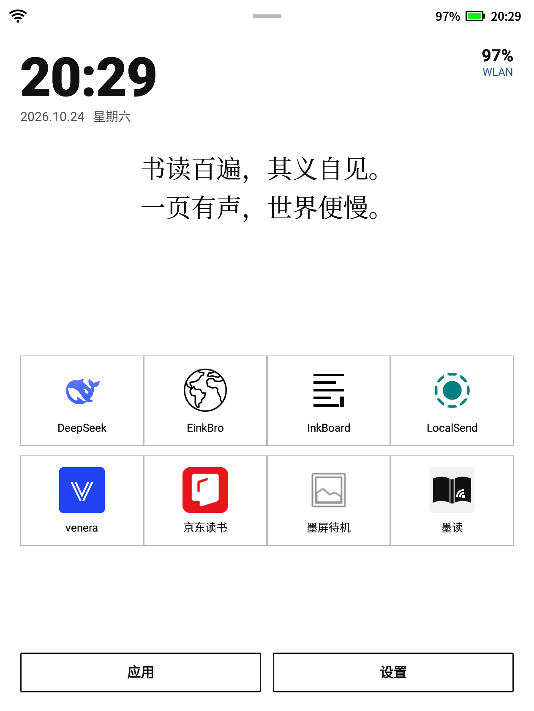
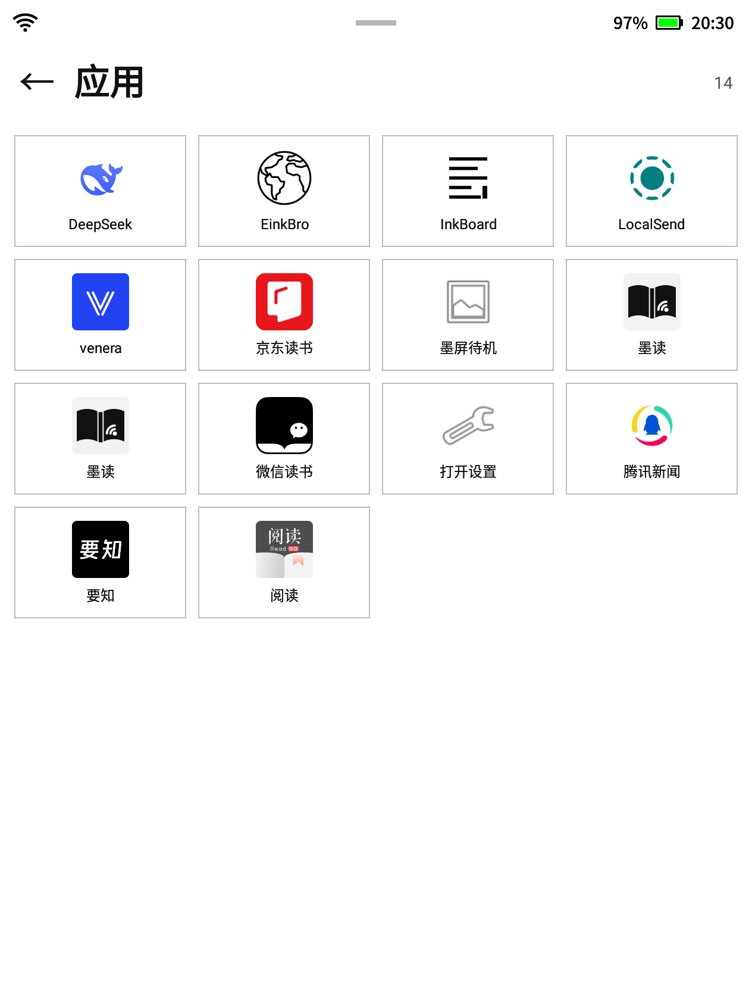
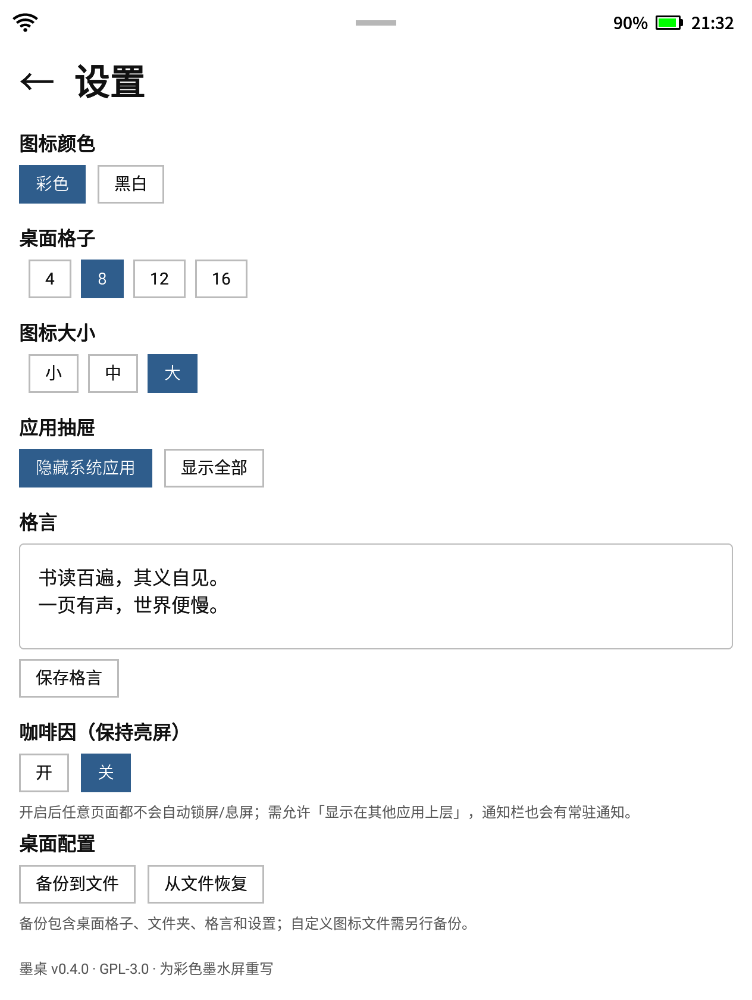
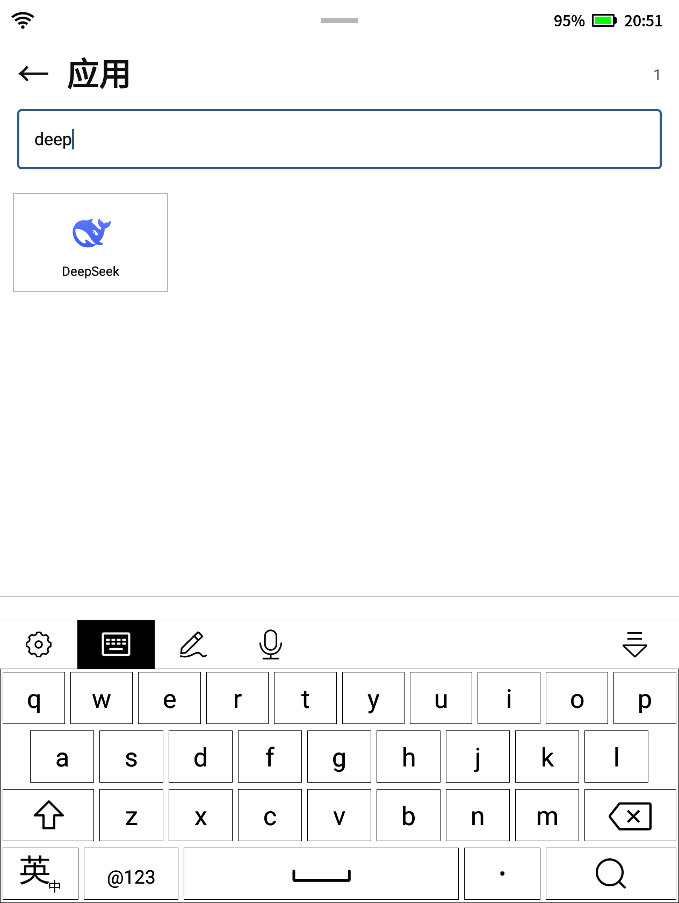
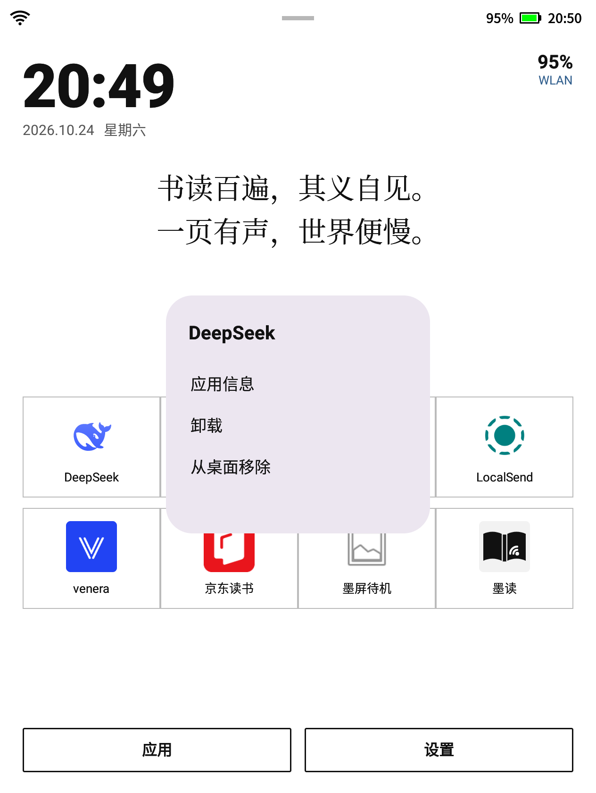
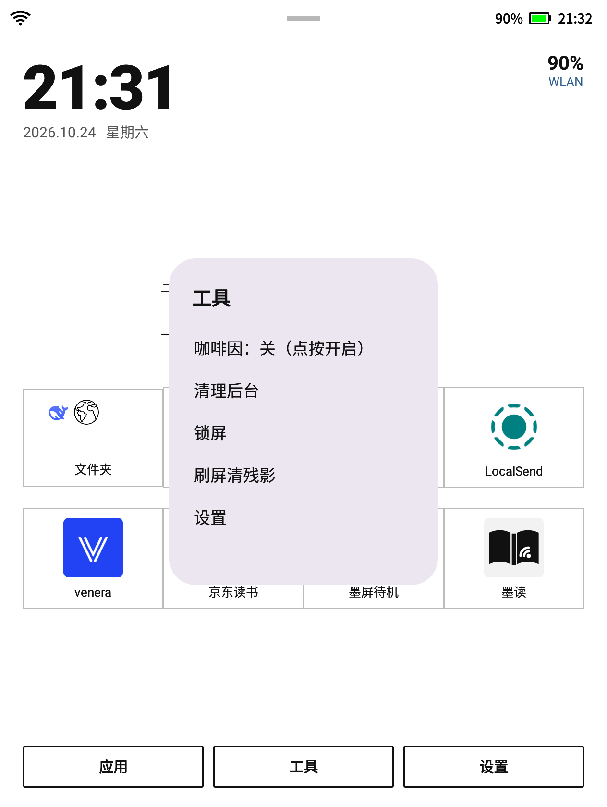
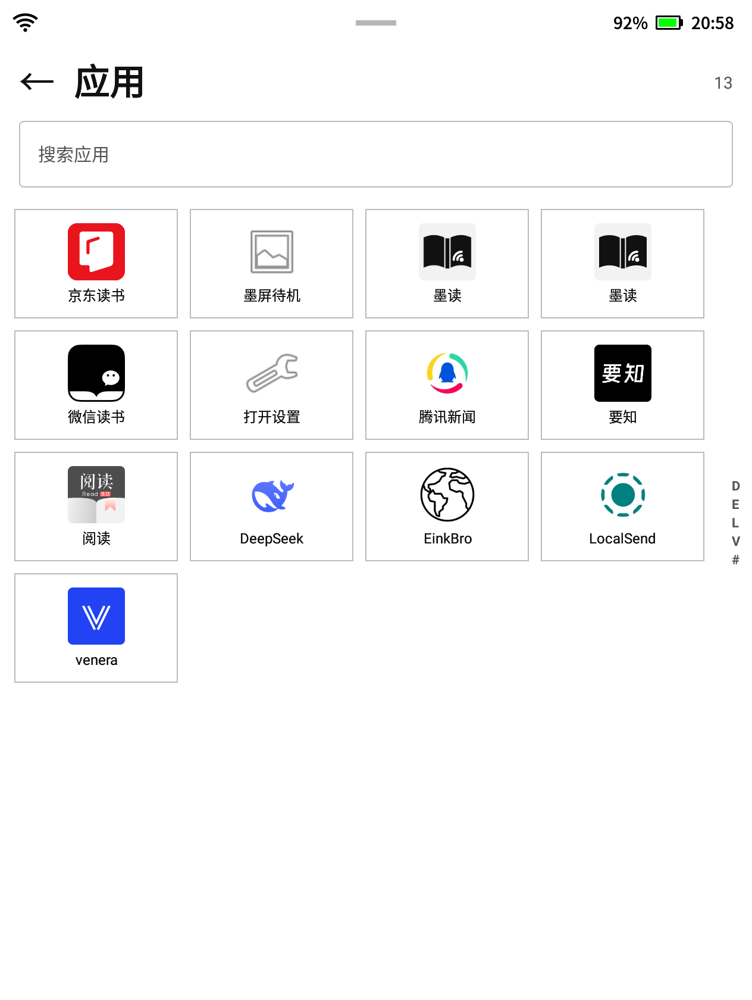
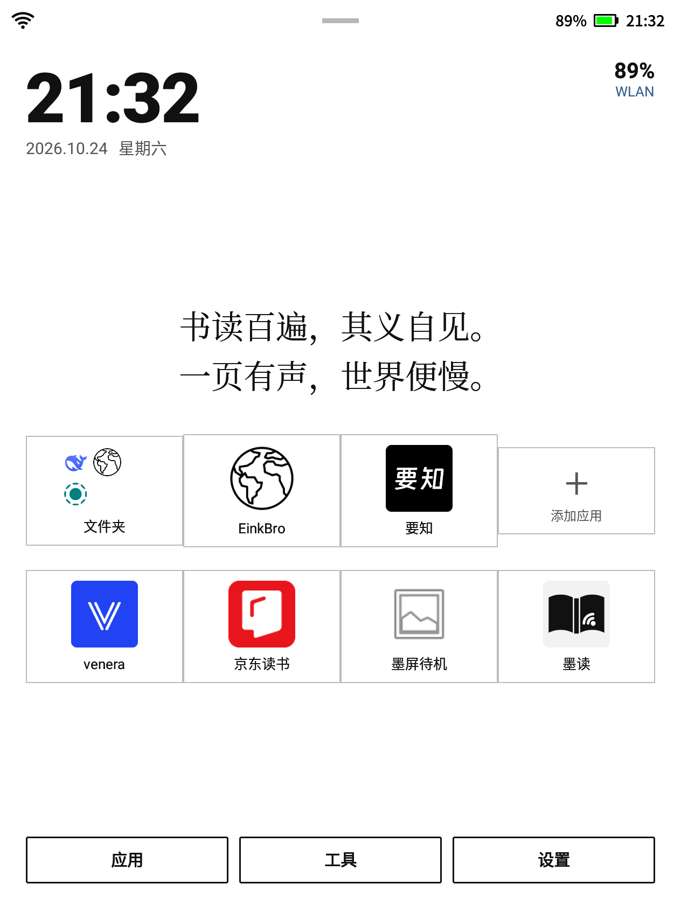
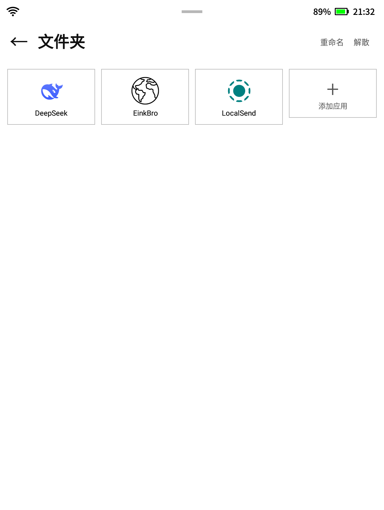

# 墨桌 · InkHome

为**彩色电子墨水屏**重写的极简 Android 桌面（Launcher）。

> 设计理念参考了 [InkBoard](https://github.com/kuaner/inkBoard)，但**代码完全重写**，未复制其源码或资源。
> 本项目以 **GPL-3.0-or-later** 开源。

## 界面预览

| 桌面 | 应用抽屉 | 设置 |
|---|---|---|
|  |  |  |
|  |  |  |
|  |  |  |

## 特性

- **白纸黑字 + 彩色图标**：保留应用原始彩色图标（可切换黑白），界面以白底黑字为主，避免彩色墨水屏大面积色块残影
- **低饱和强调色**：仅在选中项/状态处使用少量深蓝/绿/红，减少发灰
- **无动画、无涟漪**：所有点击直接重绘，适合墨水屏
- 桌面：大时钟、日期/星期、电量（充电绿/低电量红）、WiFi 状态、可编辑格言
- 应用格：4 / 8 / 12 / 16 格可选；点空位添加应用
- 应用抽屉：四列网格 + 搜索 + 右侧字母快速跳转，可隐藏系统应用
- 长按应用：应用信息 / 卸载 / 添加到桌面 / 从桌面移除 / 新建文件夹
- 文件夹：点开查看、添加/移出应用、重命名、解散
- 工具菜单：咖啡因（保持亮屏）、清理后台、锁屏（DeviceAdmin）、刷屏清残影
- 自定义应用图标（系统选图，黑白模式自动去饱和）、移动到文件夹
- 桌面配置备份/恢复（JSON）
- 咖啡因：1x1 透明悬浮窗 + FLAG_KEEP_SCREEN_ON，任意页面保持亮屏
- 按 HOME 从任何 App 返回时回到主屏；安装/卸载应用后自动刷新列表
- 设置：彩色/黑白图标、桌面格子数、图标大小、抽屉是否隐藏系统应用、格言编辑
- 完全离线，无广告、无追踪、无 GMS 依赖

## 下载

- 最新 APK：<https://github.com/xzl01/inkhome/releases/latest>
- v0.1.0：<https://github.com/xzl01/inkhome/releases/tag/v0.1.0>

## 环境

- Android 8.0+（API 26），targetSdk 34
- 构建：JDK 17–21、Android SDK（compileSdk 35 / build-tools 36.0.0）

## 构建

```bash
# 设置 SDK 路径：local.properties 或 ANDROID_HOME
./gradlew :app:assembleRelease
# 产物：app/build/outputs/apk/release/app-release.apk
```

本地 release 在未提供 `INKHOME_KEYSTORE_PATH` 时使用 debug 签名，便于侧载。

## 安装为桌面

```bash
adb install -r app/build/outputs/apk/release/app-release.apk
adb shell cmd package set-home-activity io.github.xzl01.inkhome/.MainActivity
```

> 部分厂商 ROM 会限制第三方桌面；本项目的测试设备是讯飞 XF-R3（Android 11，userdebug）。

## 设计说明

- 界面：白底、近黑正文；强调色低饱和（深蓝 `#2F5D8C`），仅用于小面积元素
- 图标：直接使用 `PackageManager` 加载原始彩色图标，按尺寸缓存；黑白模式用 `ColorMatrix` 去饱和
- 无动画、无 ripple；不做滚动列表以外的动效
- 状态：电量来自 `ACTION_BATTERY_CHANGED`，WiFi 来自 `ConnectivityManager`，时间每 20s 刷新

## 路线图

- [ ] 全刷屏幕 / 清理后台快捷入口（依赖厂商 EPD 接口）
- [ ] 更多字体/字号/行距选项

## License

GNU General Public License v3.0 or later（见 [LICENSE](LICENSE)）。
